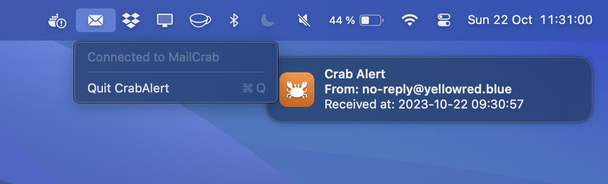

# CrabAlert 🦀🚨

CrabAlert is a macOS status bar application that notifies you of incoming messages in [MailCrab](https://github.com/tweedegolf/mailcrab).



## Features

- **Live in the Status Bar**: Runs silently in the background without a window, only showing an icon in the status bar.
- **Instant Notifications**: Get instant notifications on your desktop whenever a new message arrives.
- **Quick Actions**: Click on a notification to be taken directly to MailCrab where you can see the message.
- **Multiple Endpoints**: Always watches the default MailCrab at `localhost:1080`; add more instances (other ports, Docker hosts, staging servers) under **Settings…** in the menu, each with its own name.
- **Connection Monitoring**: Periodically checks the connection and attempts reconnection if disconnected. Connection status is shown in the status bar icon.

## App Store Screenshot

Regenerate the Mac App Store screenshot (2880×1800, the current macOS wallpaper with a CrabAlert notification) with:

```bash
swift scripts/app-store-screenshot.swift
```

It writes `screenshots/app-store-2880x1800.png`. By default it uses the dynamic "macOS" wallpaper that macOS downloads when you select it in System Settings → Wallpaper; pass `--wallpaper <image or video>` to use another one, or `--output <path>` to write elsewhere. The notification text lives at the top of the script.

## Releasing

Bump `MARKETING_VERSION` for a new release and leave the build number (`CURRENT_PROJECT_VERSION`) at `1`. App Store Connect assigns the next free build number on upload:

- **Xcode Organizer**: Archive, then Distribute App → App Store Connect, and keep **Manage Version and Build Number** ticked.
- **Command line**:

  ```bash
  xcodebuild -project CrabAlert/CrabAlert.xcodeproj -scheme CrabAlert -configuration Release -archivePath build/CrabAlert.xcarchive archive
  xcodebuild -exportArchive -archivePath build/CrabAlert.xcarchive -exportOptionsPlist CrabAlert/ExportOptions.plist -exportPath build/export -allowProvisioningUpdates
  ```
